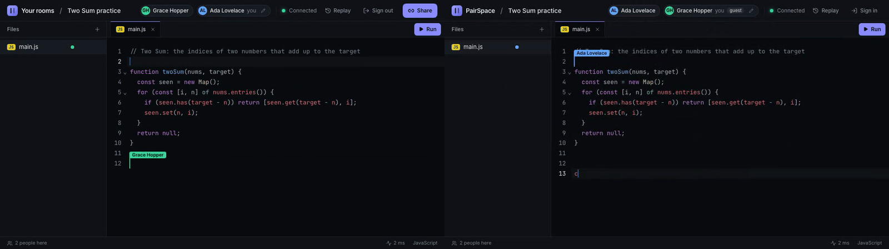
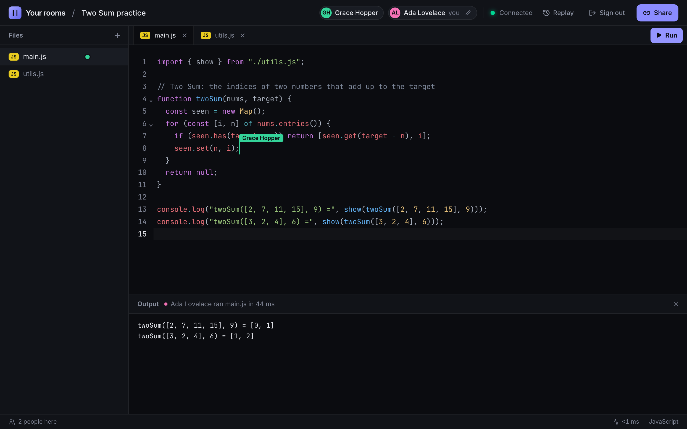
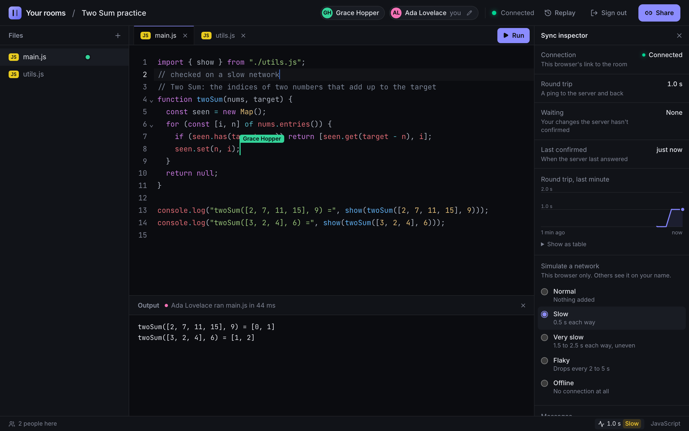
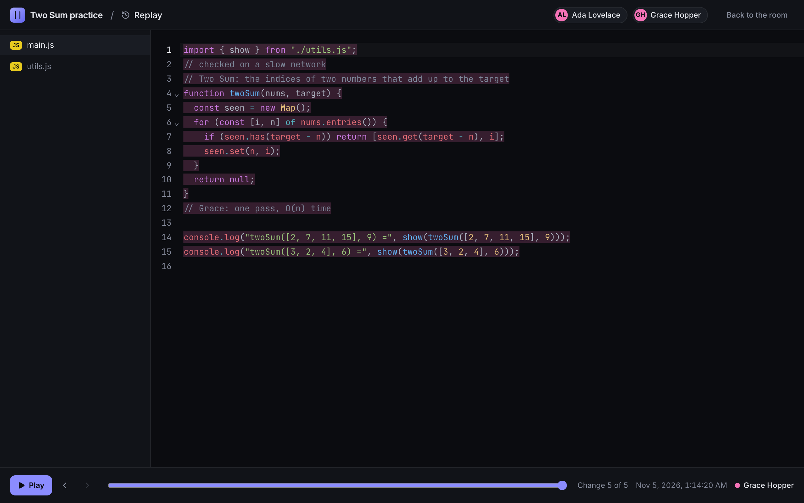
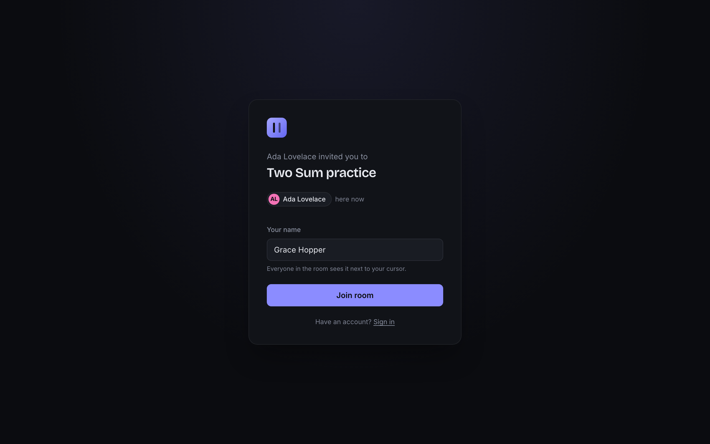
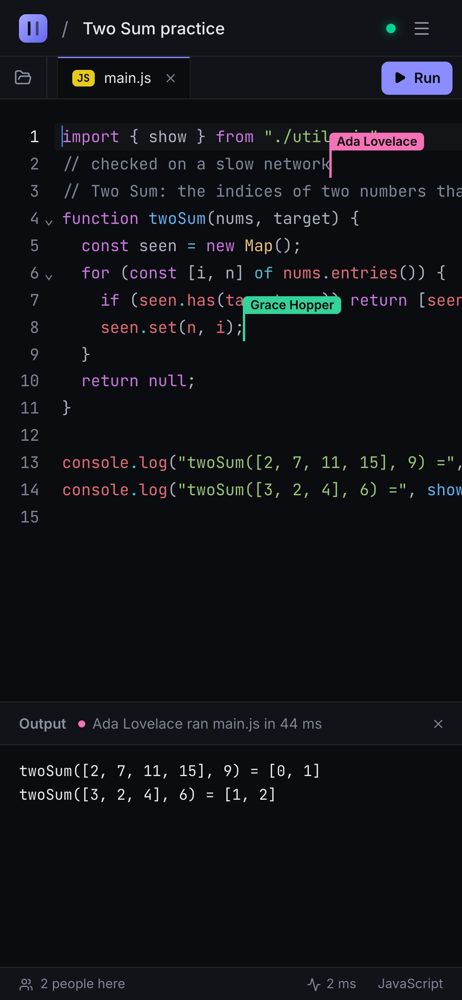
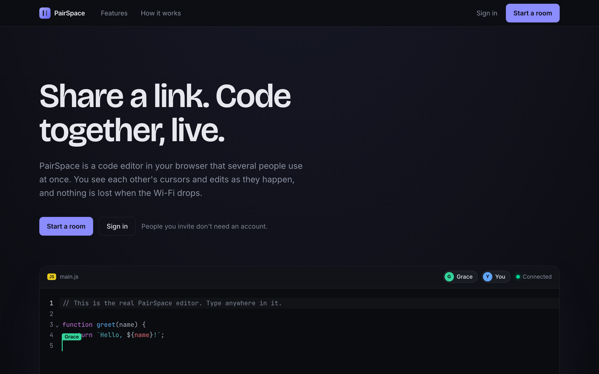
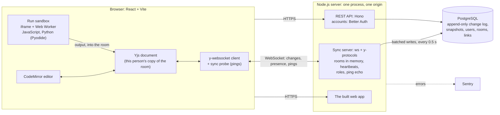

# PairSpace

**A real-time collaborative code editor.** Share a link, and everyone in the room edits the same files
live, sees each other's cursors, runs the code and replays how it was written. Built around a CRDT
sync engine, with every claim below reproducible from this repo.

**[Live demo: pairspace-27kx.onrender.com](https://pairspace-27kx.onrender.com)**: open it in two tabs and type. On the free
plan the first visit after a quiet spell takes about a minute while the server wakes.

[](https://github.com/Sriharsha-dev369/PairSpace/actions/workflows/ci.yml)
[](https://github.com/Sriharsha-dev369/PairSpace/actions/workflows/smoke.yml)



<sub>Two real browsers in one room: Ada and Grace type at the same time, each sees the other's labelled
cursor, and Ada's Run shows its output to both. Recorded from the production build by
`npm run screenshots`.</sub>

## Highlights

| | |
|---|---|
| **Consistent under faults** | 100 of 100 seeded runs converge with 0 of 11,920 characters lost, through 440 dropped connections and an offline spell per run ([the experiment](#how-every-copy-stays-identical-and-the-proof), `npm run convergence`) |
| **Own sync server** | WebSockets with heartbeats, reconnect and catch-up, roles enforced server-side, and every change saved to Postgres as an append-only log (batched every 0.5 s), from which rooms are rebuilt after a restart |
| **Runs untrusted code safely** | JavaScript and Python (Pyodide, WebAssembly) in a sandboxed iframe with no access to the session, inside a Web Worker with a time limit; tested in Chromium, WebKit (Safari) and Firefox |
| **Tested** | 355 automated tests (Vitest, Playwright), new ones mutation-checked; CI on every push gates every deploy |
| **Fast and accessible** | 62% less JavaScript on the first page (363 → 138 kB gzipped) by splitting code per page; every page passes axe's automated WCAG 2.1 AA checks |

## Features

- **Rooms by link:** edit or view-only share links; turning one off disconnects whoever used it, at once.
- **Live co-editing:** names, colours and labelled cursors, who's in which file, multi-file projects with folders, and a trash with restore.
- **Run:** JavaScript (with imports between the room's files) and Python, in the browser of whoever pressed Run; everyone sees the output.
- **Replay:** step or play through a room's whole history, each person's text in their colour.
- **Sync inspector:** live round trip, changes the server hasn't confirmed yet, a message log, and a simulated slow, flaky or offline network to watch the copies still converge.
- **Accounts:** email and password or GitHub; guests join by invite with a name, no account needed.
- **Everywhere:** works on phones; edits made offline merge when the connection returns.

## Screenshots

| | |
|---|---|
|  |  |
| **A room:** two files, another person's cursor, and a run's output, shared with everyone | **Sync inspector:** a simulated slow network adds 0.5 s each way, so the round trip becomes 1.0 s |
|  |  |
| **Replay:** the room at any step, coloured by who wrote what | **Invite:** whose room it is, who's there now, and your name |

<p align="center">
  
  &nbsp;&nbsp;
  
</p>

## Architecture



- **Local-first:** typing changes the browser's own copy at once, so the network is never in the way;
  the sync server relays changes to everyone else in the room and saves them.
- **One server, one origin:** it serves the web app, the API and the WebSockets, so the session cookie
  is first-party and needs no CORS. It checks its settings at start and reports healthy only when the
  database answers.
- **Rooms live in memory** while anyone's in them, are rebuilt from the change log (with snapshots
  every 100 changes) when someone joins, and leave memory 30 s after the last person.
- **Run is isolated:** the sandbox iframe has an opaque origin, so code run there can't use the
  person's session; its output is written into the room's document, so everyone sees it.

## How every copy stays identical, and the proof

Each person edits their own copy of the room, and the server only relays and saves changes, so typing
never waits for the network. The copies are [Yjs](https://yjs.dev) CRDT documents: every inserted
character gets a unique id (the author's client id and a counter) and is placed relative to its
neighbours, so concurrent edits merge in the same order on every copy with no central lock, and
applying a change twice or late changes nothing. After a reconnect, each side sends a summary of what it
has (a state vector) and receives only what it's missing, which is how offline typing merges back in.
The relay is my own WebSocket server (`server/src/sync-server.ts`): heartbeats, reconnects, an
append-only change log in Postgres.

**The experiment** (`server/test/convergence.ts`): three clients edit one room on the real sync server,
each through its own fault-injection TCP proxy (`server/test/faulty-network.ts`), making 60 edits at
random positions per run. Every run is done twice with the same seeded edits:

- **clean**: no faults
- **faulty**: 10-50 ms delay each way, a connection reset every 10 edits, and one client offline for
  20 of the 60 edits (it keeps typing, and merges when it's back)

A run passes when all three copies have the same text and the same state vector, and every character
typed is there. *Settle* is the time from the last edit until all three copies match.

```
npm run convergence            # 100 runs per network, ~2.5 minutes, no database needed
npm run convergence -- 500     # any number of runs; run i always uses seed i
```

Results on 2026-11-04 (Apple M5, everything on one machine):

| Network | Runs converged | Characters lost | Connections dropped | Settle median | p95 | max |
|---|---|---|---|---|---|---|
| clean | 100/100 | 0 of 11,920 | 0 | <1 ms | 3 ms | 3 ms |
| faulty | 100/100 | 0 of 11,920 | 440 (4.4 per run) | 303 ms | 508 ms | 547 ms |

What the numbers mean:
- Everything runs on one machine, so settle times measure merging and reconnecting, not distance on
  the internet.
- Most of the faulty settle time is the client's reconnect wait. It uses y-websocket's own timing, as
  the app does: the first retry comes after 200 ms.
- Times vary by a few percent between runs. Convergence and loss don't.
- CI reruns the experiment on every push, with 20 runs per network, and fails if any run doesn't
  converge or loses anything.
- The sync server's own tests (`npm test -w server`, "unreliable network") cover catch-up, offline
  merges, slow links, and a chaos run with a fresh random seed each time.

## Tech stack

| Layer | Tools | Why these |
|---|---|---|
| Sync | Yjs (CRDT), y-protocols, `ws` | Edits merge without a central lock; the server is my own, for heartbeats, roles and persistence |
| Frontend | React 19, Vite, React Router, TanStack Query, CodeMirror 6, Tailwind CSS, Radix | A fast editor and an accessible UI, with each page's code loaded only when visited |
| Backend | Node.js 24, TypeScript, Hono, Better Auth (email, GitHub OAuth) | One small server for the API, accounts and WebSockets |
| Data | PostgreSQL, Drizzle ORM | An append-only change log powers both recovery and replay |
| Run | Pyodide (WebAssembly), sandboxed iframe + Web Worker | Code runs in the browser, isolated from the app |
| Quality | Vitest, Playwright, axe-core, Biome, knip, GitHub Actions | Tests at every level; dead code and lint fail CI |
| Production | Render, Neon, Sentry (all free plans) | Deploys from `render.yaml` once CI passes; errors reported |

## Testing and quality

| What | How | Count |
|---|---|---|
| Server: sync protocol, persistence, auth, roles, API | Vitest, against a real Postgres | 126 |
| Web: room session, sync probe, simulated network, files, replay, Run | Vitest, against the real sync server | 114 |
| End to end: every flow, phones, crashes, offline, accessibility | Playwright on the production build: Chromium, WebKit, and Firefox in CI | 115 |
| Convergence under faults | `npm run convergence`: 100 seeded runs per network; CI reruns 20 | 200 runs |

- Every new test was mutation-checked: the code it covers was broken on purpose, and the test had to fail.
- Accessibility: axe scans every page and its dialogs, phone layout included, for WCAG 2.1 A and AA.
- A smoke test (`e2e/smoke.spec.ts`) checks any deployed site with `BASE_URL=…`, and runs daily from GitHub Actions.
- Every design decision, with the reasons and the alternatives turned down, is in [`context.md`](context.md) (105 entries).

## Run it

Requires Node 24 or newer (`nvm use` reads `.nvmrc`) and Docker (for Postgres).

npm workspaces: `server/` (API and sync server) and `web/` (the React app). Run everything from the repo root.

```
npm install
cp .env.example .env    # optional: GitHub sign-in needs an OAuth App's id and secret (see the file)
npm run db:up           # Postgres in Docker on localhost:5433 (npm run db:down to stop)
npm run dev -w server   # server on ws://localhost:8080 (restarts on change)
npm run dev -w web      # web app on http://localhost:5173 (sign up there to start a room)
npm test                # all automated tests (Vitest; server tests need db:up)
npm run typecheck       # TypeScript check, all packages
npm run lint            # Biome check; npm run format to fix
npm run test:e2e        # browser tests (Playwright; first time: npx playwright install chromium)
npm run build           # production build, all packages
npm run build -w server && npm start -w server   # compiled server
npm run convergence     # the convergence experiment (no database needed)
npm run screenshots     # retake the README's pictures and GIF (needs ffmpeg)
```

CI (GitHub Actions, `.github/workflows/ci.yml`) runs the same checks on every push to `main` and every pull request.

## Deploy it

Free: Render's free web service (from `render.yaml`; it sleeps after 15 minutes without visitors and
takes ~30-60 s to wake), Neon's free Postgres, and Sentry's free plan for errors. The steps only a person can do (accounts, secrets, the GitHub OAuth App) are a guided script:

```
bash scripts/deploy-wizard.sh
```

Then `.github/workflows/smoke.yml` checks the site every day (set the `PRODUCTION_URL` repository
variable; the wizard does), or by hand: `BASE_URL=https://… npx playwright test e2e/smoke.spec.ts --project chromium`.

## Known limitations

- On Render's free plan the server sleeps after 15 minutes without visitors; the next one waits about a minute while it wakes.
- No password reset or email verification yet (they need an email service).
- Run has no npm or PyPI packages and no `input()`; TypeScript files don't run yet.
- Two guests showing the same name are one person in replay.
